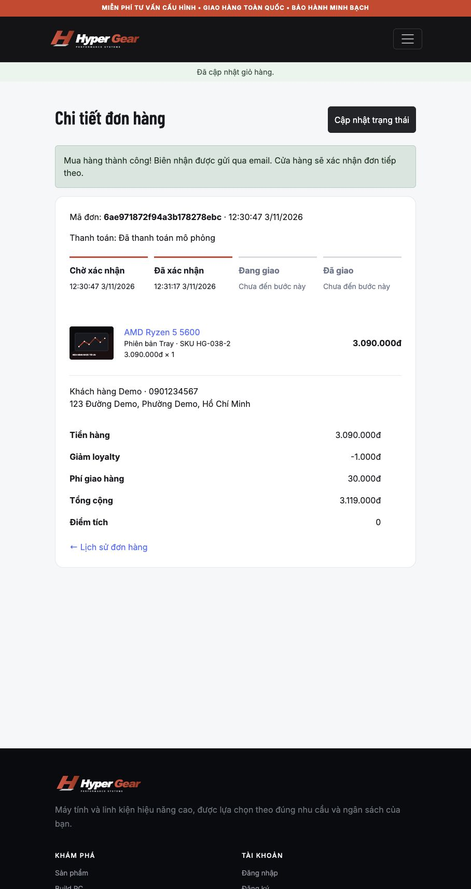

# Kết quả kiểm thử M1–M2

Repository: ZaTriu2001/Final_NodeJS_HyperGear. Commit nghiệp vụ đã kiểm thử: `4570fbafc209c0006302ebc6c35d2e7ada366462`, nhánh `feature/m1-m2-completion`.

## Kết quả tự động

| Bộ kiểm thử | Kết quả | Phạm vi |
|---|---|---|
| ESLint / production build | Đạt | React và bản build Vite |
| Frontend (Vitest/jsdom) | 11/11 đạt | Cart persistence, merge/retry, auth guard, checkout idempotency, URL filter/pagination |
| Finance unit | 3/3 đạt | Revenue/profit và quy tắc loyalty |
| Integration trên MongoDB replica set | 12/12 nhóm đạt | Auth/session, địa chỉ, cart, ownership, transaction, cạnh tranh tồn kho, reset password |
| RabbitMQ + SMTP | 1/1 đạt | Gửi thư, bỏ qua replay, retry 5 lần, dead-letter |
| Browser E2E Chromium | 4/4 đạt trên CI | Desktop 1440px và mobile 390px; menu/filter/pagination, guest → register → checkout → reload order |
| Postman collection qua Newman | 18 request / 19 assertions đạt | Auth, catalog, cart, quote, payment, replay, history, loyalty, admin confirmation/metrics |
| Live smoke | Đạt | Catalog → login → cart → quote → payment → admin confirmation → RabbitMQ → 3 email SMTP |
| Production dependency audit | Đạt | Không có cảnh báo trong lượt audit production đã chạy |

Bằng chứng CI: [HyperGear CI run 41485320087](https://github.com/ZaTriu2001/Final_NodeJS_HyperGear/actions/runs/41485320087). Toàn bộ job thành công, bao gồm dựng Docker Compose, browser và messaging. Ảnh/report được lưu trong artifact `browser-qa`, ID `13161197190`, giữ đến hạn retention của GitHub.

Các bộ local, integration, SMTP, smoke và Postman nêu trên đã được chạy trong lượt kiểm thử trước khi tiếp tục demo giao diện. Kết quả browser được xác minh trực tiếp từ CI của đúng commit, không được tính từ jsdom.

## Kiểm thử trực tiếp trên giao diện HyperGear

1. Mở giỏ khách có AMD Ryzen 5 5600, phiên bản Tray (SKU HG-038-2).
2. Tăng số lượng 1 → 2: tiền hàng 3.090.000đ → 6.180.000đ, không tải lại trang; đưa về 1.
3. Vào checkout khi chưa đăng nhập: hệ thống yêu cầu đăng nhập hoặc tạo tài khoản.
4. Đăng nhập customer demo: quay lại checkout, gộp giỏ khách vào cart tài khoản.
5. Dùng 1.000 điểm: tiền hàng 3.090.000đ, discount 1.000đ, ship HCM 30.000đ, tổng 3.119.000đ, điểm sẽ tích 0.
6. Chọn payment failure: nhận thông báo thất bại, vẫn có thể thử lại.
7. Chuyển payment success: tạo đơn `6ae971872f94a3b178278ebc`.
8. Đọc MongoDB và assertion: points 135.000 → 134.000, tồn SKU 13 → 12, cart rỗng, số đơn customer 5 → 6, earnedPoints = 0 và totalPaid = 3.119.000.
9. Xác nhận đơn bằng admin API, cập nhật trang đơn: timeline hiện bước đã xác nhận.
10. Mailpit có đúng 2 thư gắn mã đơn: biên nhận và xác nhận của cửa hàng. Không gửi email ra Gmail thật.

Demo: [Website](http://localhost:8080) · [Mailpit](http://localhost:8025). Đây là địa chỉ trên laptop, không phải website public.

## Chưa thể nghiệm thu hoàn tất

- Google OAuth: chưa có GOOGLE_CLIENT_ID / GOOGLE_CLIENT_SECRET trong cấu hình. Code đã có nhưng chưa chứng minh đăng nhập Google thật thành công.
- Gallery dùng SVG minh họa; chưa phải ảnh chính hãng của từng model. Cần đối chiếu lại dữ liệu sản phẩm trước nộp.
- Browser test dùng Chromium với viewport mobile; chưa xác minh Safari hoặc iPhone thật, cũng không chứng minh toàn bộ khả năng truy cập của website.
- Docker đã chạy thành công trên GitHub runner; bản demo hiện tại trên Mac dùng Node/MongoDB/RabbitMQ/Mailpit native.
- Full dependency audit còn 6 cảnh báo moderate trong chuỗi dev-tool ESLint/minimatch; không nằm trong production audit đã đạt.
- M3/M4 vẫn còn trong backlog; các kết quả trên không đồng nghĩa toàn dự án hoặc toàn rubric đã đạt 100%.

## Lệnh chạy lại

Dùng Node 24; bật demo hoặc Docker trước khi chạy Postman/smoke/browser. Test integration và messaging dùng database kiểm thử riêng; test smoke/browser/Postman tạo tài khoản hoặc đơn demo thật trong database demo. Không chạy các script này với dữ liệu production.

~~~sh
npm run lint
npm test
npm run build
npm run test:integration
npm run test:messaging
npm run test:smoke
npm run test:browser
~~~

Import `postman/HyperGear.postman_collection.json` vào Postman và chạy theo thứ tự; collection tự giữ cookie và lưu ID cho các request tiếp theo. Browser local cần Chromium của Playwright; nếu máy không cho khởi chạy browser, xem kết quả cùng ảnh trên CI.
